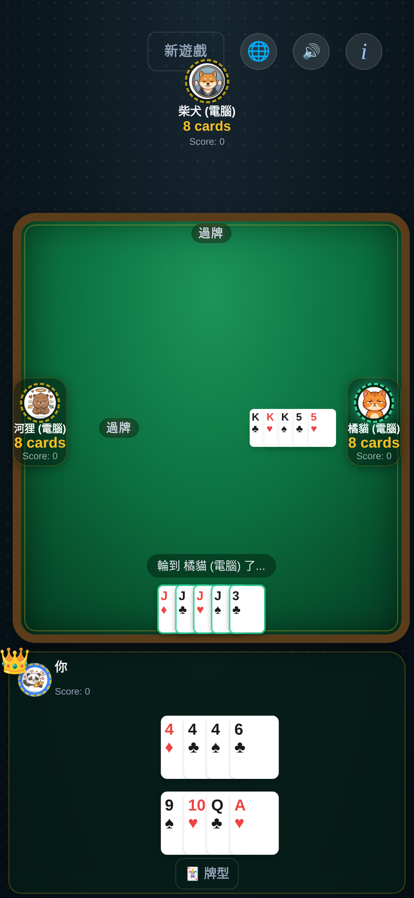
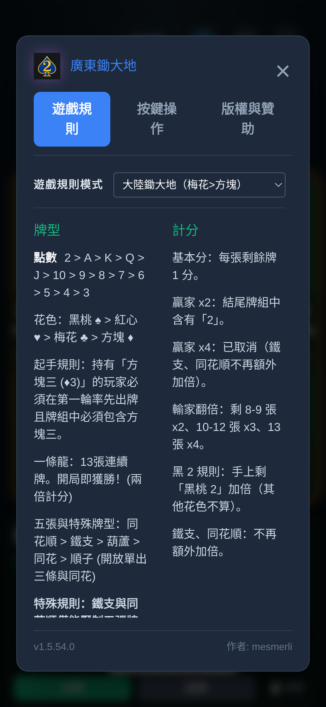

# 廣東鋤大地（Android 豎屏版）

[](https://www.gnu.org/licenses/agpl-3.0)
[-brightgreen.svg)](https://capacitorjs.com/)
[](./Documents/changelog.md)
[](#-本機-ai不連網)

以 [Capacitor](https://capacitorjs.com/) 打包的**只支援安卓豎屏**的「廣東鋤大地」（大陸鋤大地規則）。

本分支 fork 自開源專案 **Taiwan Big2 AI**（作者 [mesmerli](https://github.com/mesmerli/taiwan-big-two-ai)，AGPL-3.0），並做了三件事：**移除所有大模型功能**、**改成大陸鋤大地規則**、**重做成單手可玩的豎屏牌桌**。

<p align="center">
  
  
</p>

> 桌面中央 = 各家打出的牌（上=柴犬、左=河狸、右=橘貓、下=自己）；下方 = 自己的手牌，自動分成兩排並標出五張牌型。

---

## ✨ 本分支改動一覽

| | 上游（台灣大老二 AI） | 本分支 |
|---|---|---|
| 遊戲名稱 | 台灣大老二 AI | **廣東鋤大地** |
| 螢幕方向 | 桌面／橫屏 | **鎖定豎屏** |
| 規則 | 台灣 + 香港 | **預設大陸鋤大地** |
| 對手 | 規則 AI + 大模型（WebGPU／相容 OpenAI 的 API） | **只有本機規則 AI** |
| 大模型功能 | AI 設定、模型快取、賽後復盤 | **全部移除**（不連網、不需 API Key） |
| 計分 | 鐵支／同花順額外翻倍 | **取消額外翻倍**，改按剩餘張數 |
| 手牌排列 | 單排 | **自動 2–3 排、按五張牌型聚組** |
| 出牌顯示 | 座位旁的小牌槽 | **落在桌面上、按方位擺放** |

---

## 🎴 規則（大陸鋤大地）

- **點數大小**：2 > A > K > Q > J > 10 > 9 > 8 > 7 > 6 > 5 > 4 > 3
- **花色大小**：♠ 黑桃 > ♥ 紅心 > ♣ 梅花 > ♦ 方塊 —— 即 **梅花大於方塊**
- **起手牌**：持 **方塊 3（♦3）** 的玩家先出，且第一手必須包含 ♦3
- **牌型**：單張、對子、三條、五張（順子／同花／葫蘆／鐵支／同花順），以及**一條龍**（13 張連續牌，直接獲勝）
- **五張大小**：同花順 > 鐵支 > 葫蘆 > 同花 > 順子
- **怪物（鐵支／同花順）**：只能壓五張牌型，不能用來壓單張、對子或三條 —— 這只影響合法性，**不影響計分**
- **拉（Shout）**：出牌後剩一張必須喊「拉」，最後一張必須是手中最大的牌

### 計分

| 情況 | 倍數 |
|---|---|
| 基本分 | 每張剩餘牌 1 分 |
| 輸家剩 8–9 張 | ×2 |
| 輸家剩 10–12 張 | ×3 |
| 輸家剩 13 張（一張未出） | ×4 |
| 輸家手上剩 **黑桃 2** | ×2（只認黑桃 2，梅／方／紅心的 2 不算） |
| 贏家結尾牌組含 **黑桃 2** | ×2（只認黑桃 2，梅／方／紅心的 2 不算） |
| 鐵支／同花順 | **不再額外加倍**（本分支已取消） |

贏家得分 = 三家輸分總和。

---

## 📱 介面重點

- **鎖定豎屏**（`android:screenOrientation="portrait"`），不旋轉、不黑邊
- **牌桌層次**：深色地毯 → 木質桌沿 → 綠色絨面；三名對手分別坐在桌子的上方、左側、右側，自己在最下方
- **出牌落在桌面上**：按座位方位擺放，當前最大一手加綠色描邊，空位自動隱藏，「過牌」顯示為小膠囊
- **手牌自動聚組**：按五張牌型（同花順 > 鐵支 > 葫蘆 > 同花 > 順子）分排，五張牌一眼可辨
  - 「牌型」按鈕三態切換：**牌型（兩排）→ 5張（每排 5 張）→ 單排**
  - 13 張 = 7+6、10 張 = 5+5、7 張 = 4+3
- **選牌不遮鄰牌**：牌是疊排的，選中時只抬起＋描邊，不會蓋住旁邊那張的點數
- **矮屏緊湊版**（視口高度 ≤760px）：牌面、座位、按鈕同步收小，不裁切任何內容
- 支援繁中／英文切換、音效、桌面鍵盤快捷鍵

---

## 🤖 本機 AI，不連網

三位對手（柴犬／河狸／橘貓，另有 Alex／Bella／Chris）全部使用 `src/ai/HeuristicAI.js` 的本機啟發式規則：

- **Alex** — 均衡、重位置
- **Bella** — 防守，炸彈留到後期
- **Chris** — 激進，先丟大牌
- 動物角色（河狸／柴犬／橘貓）— 混合策略，各有說話風格

**沒有任何 HTTP 請求、不需要 API Key、不下載模型、不上報任何資料**。`window.AISummary`、WebLLM、LM Studio 橋接在本分支已全部刪除。

### 啟發式之上：ISMCTS 再排序（`src/ai/ChudadiEngine.js`）

每個合法動作的基準分數來自拆牌 DP `f(H)` + 手牌價值 `V(H)` + 精確零和收益（論文 §7、§2.3）；只有在**差距 4 分以內**的幾個候選上，才用輕量資訊集 MCTS（論文 §6，移植自論文配套的 Java 參考實作）再排一次：

| 項目 | 數值 |
|---|---|
| 牌型枚舉自檢 | **19,898**（單52／對78／三條52／順10,200／同花5,108／葫3,744／四帶一624／同花順40） |
| 結算自檢 | 剩 5/8/0/12 張 → **37 / −7 / 57 / −87** |
| 搜索觸發率 | 決策的 **8%**（只搜接近的候選） |
| 單次成本 | **約 39ms**／200 次迭代（真機上限 400ms） |
| 配對 A/B，160 局 | **每副 +2.16 分**（se 0.98），更好 13／更差 9／持平 138 |
| 遊戲內開關 | **i → 對手強度分頁**（與「遊戲規則」並排）：*普通 · 反應快*（預設，不搜索）／*困難 · 會算*（200 次迭代） |
| 儲存位置 | `AppStorage('aiLevel')` = `normal` / `hard`，每次決策都重讀，切換立即生效 |

確定化只看自己的手牌 + 公開資訊（已出的牌、各家張數、桌面），不會偷看。滾動用啟發式策略（ε=0.08），`max^n` 回傳用真實的兩兩計分。兩道安全閥：台/港規則（有炸彈、順子窗口不同）直接跳過搜索；啟發式首選明顯領先時不翻盤。

```bash
node scripts/engine-test.js        # 規則：19,898 牌型、結算、500 局隨機對局、Θ5
node scripts/ai-search-test.js     # 整合：合法性 + 每次決策耗時
node scripts/app-ai-game-test.js 40 200   # 配對強度 A/B（40 副 × 4 座位）
```

點擊頭像即可替換該座位的角色 —— 全部都在本機。

---

## 🛠️ 建置

### 環境需求

| 工具 | 版本 |
|---|---|
| Node.js | ≥ 18 |
| JDK | **21**（Gradle 8.14 要求） |
| Android SDK | platform 36 + build-tools 35/36 |
| Gradle | 8.14.x（或用專案 wrapper） |

### 1. 同步前端資源

```bash
npm install
npm run sync-www          # src/ + index.html → www/（唯一來源）
```

### 2. Debug APK

```bash
npx cap sync android
cd android
export JAVA_HOME=/path/to/jdk-21
export ANDROID_HOME=/path/to/android-sdk
./gradlew assembleDebug
```

產物：`android/app/build/outputs/apk/debug/app-debug.apk`

### 3. Release 簽名包

建立 `android/keystore.properties`（已列入 `.gitignore`）：

```properties
storeFile=/absolute/path/to/release.jks
storePassword=******
keyAlias=******
keyPassword=******
```

```bash
cd android && ./gradlew assembleRelease
```

產物：`android/app/build/outputs/apk/release/app-release.apk`（v2 + v3 簽名）

> release 與 debug 簽名不同，同一 `applicationId` 換簽名安裝前必須先卸載舊版。

### 4. 安裝

```bash
adb install -r android/app/build/outputs/apk/release/app-release.apk
```

---

## 🧪 測試

```bash
npm test                  # node tests/logic.test.js —— 規則引擎 17 項
```

涵蓋牌張比較、牌型判定、首手必含 ♦3、怪物合法性、以及大陸花色順序（♣ > ♦）。

---

## 📁 專案結構

```text
index.html                 # 遊戲主畫面（單頁）
src/
├── renderer.js            # 啟動：綁定控制器與視圖
├── gameLogic.js           # 規則：BaseRules / TaiwanRules / HongKongRules / MainlandRules
├── ai/
│   ├── AICharacter.js     # 角色基底（名稱、頭像、決策接口）
│   ├── HeuristicAI.js     # 本機規則 AI（Alex/Bella/Chris + 動物角色）
│   └── BigTwoAI.js        # 四個座位的管理器，掛在 window.AI
├── controllers/
│   ├── GameController.js  # 發牌、回合流程、合法性檢查、計分
│   ├── SettingsController.js
│   └── KeyboardController.js
├── views/GameView.js      # 手牌分排、桌面出牌、座位、RWD 切換
├── services/              # 授權／系統輔助
├── styles.css             # 桌面格狀版面 + 豎屏手機版面
└── i18n.js                # 繁中／英文字串
android/                   # Capacitor 安卓專案（鎖定豎屏）
www/                       # 由 src/ 產生的副本（勿直接編輯）
Documents/                 # 架構、建置指南、分支說明
```

---

## 🧭 分支範圍

- 本分支**只支援安卓豎屏**。Electron／Tauri 桌面外殼仍留在 repo，但**未在本分支驗證**。
- 上游的 Microsoft Store／MSIX／試用授權／StoreBridge 在本分支不使用。
- 介面預設繁體中文，若要簡體可在 `src/i18n.js` 增加語系。

---

## 📜 授權與致謝

- 原始專案：[Taiwan Big2 AI](https://github.com/mesmerli/taiwan-big-two-ai)，作者 **mesmerli**，授權 **AGPL-3.0**
- 本 fork 沿用同一授權：**GNU AGPL-3.0**，衍生作品必須同樣開源
- 規則改寫、豎屏版面、移除大模型：本分支（`android-portrait`，維護者 seagaruda）

詳細變更見 [changelog](./Documents/changelog.md)，模組說明見 [architecture](./Documents/architecture.md)。
